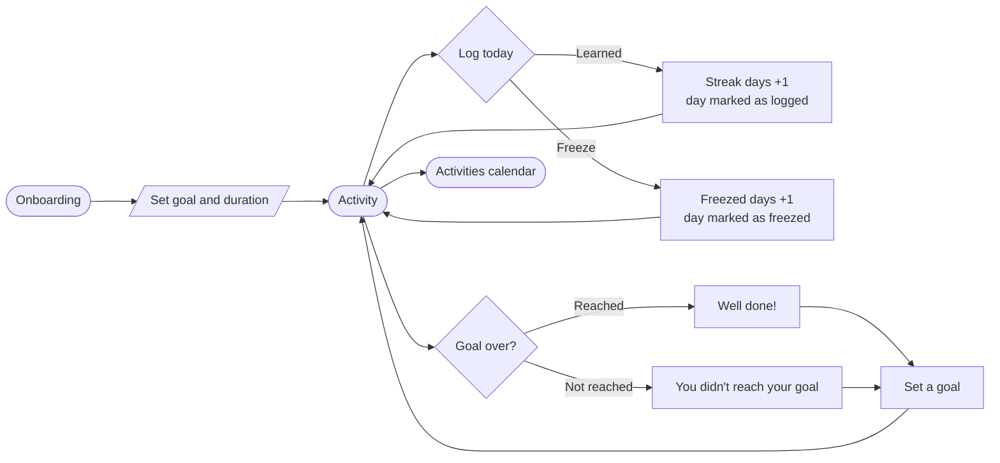
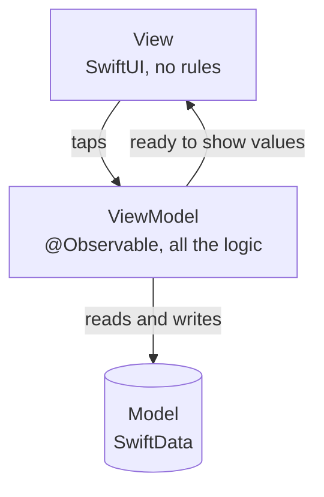
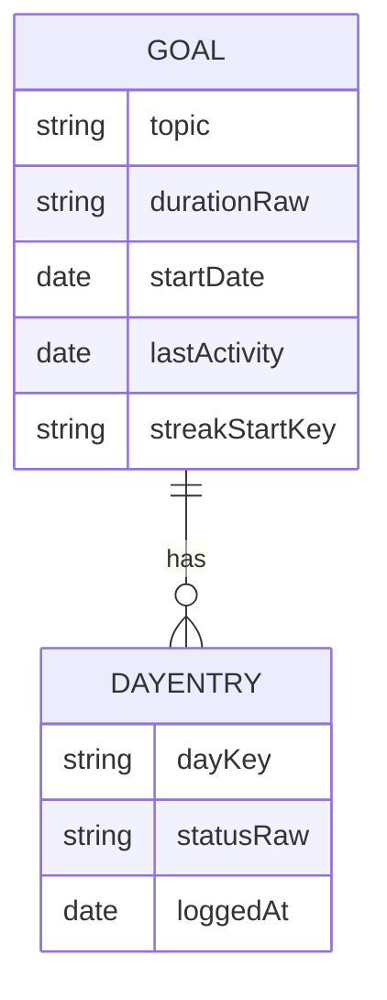

<p align="center">
  
</p>

<h1 align="center">Learning</h1>

<p align="center">
  <b>Set a goal. Keep your streak. Learn something every day.</b>
</p>

<p align="center">
  
  
  
  
  
</p>

<p align="center">
  <a href="#about">About</a> ·
  <a href="#features">Features</a> ·
  <a href="#how-it-works">How it works</a> ·
  <a href="#user-flow">User flow</a> ·
  <a href="#design-system">Design</a> ·
  <a href="#architecture">Architecture</a> ·
  <a href="#getting-started">Getting started</a>
</p>

---

## About

**Learning** is a small iOS app that helps you build a daily learning habit.
You choose what you want to learn and how long you want to take, a week, a month or a year,
then you log every day you studied. Your streak grows with each learned day. If life gets in the way,
you can **freeze** a day to protect the streak, but freezes are limited, so use them wisely.

Everything is stored on the device. There are no accounts and no network calls.

<!--
SCREENSHOTS
Add your screenshots to docs/screenshots/ and uncomment this block.

<p align="center">
  
  
  
  
</p>
-->

---

## Features

| | |
|---|---|
| **Start learning** | Type what you want to learn and pick Week, Month or Year |
| **Log your day** | One tap on the big orange circle marks today as learned. Tap again to undo |
| **Freeze a day** | Protect your streak when you can't study. Tap again to undo |
| **Streak and counters** | Learned days and freezes used, always up to date |
| **Week at a glance** | The current week with learned days in orange and freezed days in cyan |
| **Activities calendar** | A read-only calendar of the whole year that opens on the month you are in |
| **Goal results** | A "Well done!" screen when you reach your goal, or a gentle nudge when you don't |
| **Change your goal** | Update the topic or duration any time, with a warning that the streak starts over |
| **Always dark** | A dark interface with Liquid Glass buttons throughout |

---

## How it works

### The rules

| Rule | Behavior |
|---|---|
| **Goal length** | A week goal is 7 days, a month goal is 30 days and a year goal is 365 days |
| **Freeze limits** | **2** freezes per week goal, **8** per month goal, **96** per year goal |
| **Streak reset** | If you don't log a learned day or a freeze for more than **32 hours**, the streak starts over |
| **Updating the goal** | Changing the goal resets the streak, the freezes and the progress |
| **New day at 12 AM** | The buttons become available again at midnight, even if you logged at 11 PM |
| **Freeze button** | Disabled when all freezes are used. Tapping it on a freezed day gives the freeze back |
| **Completed** | The logged days (learned or freezed) reach the goal length |
| **Not met** | The goal period ended and the logged days did not reach the goal length |
| **Wording** | A count of 1 reads **"1 Day"**. Anything else reads **"4 days"** |

### One day, one status
Each calendar day has at most one status: **learned**, **freezed** or **empty**.
Switching is allowed. Logging a freezed day turns it into a learned day and gives the freeze back,
and freezing a learned day turns it into a freezed day.

---

## User flow



| Task | Screen |
|---|---|
| 1. Start learning | Onboarding, then the Activity page |
| 2. Log a day as learned or freezed | Activity |
| 3. Set a new or the same goal when the goal ends | Activity result state and the Learning Goal screen |
| 4. Change the learning goal | Learning Goal screen with the "Update goal" alert |
| 5. See all previous learned days | Activities calendar (view only) |

---

## Design system

### Colors

| Color | Swatch | Hex | Used for |
|---|---|---|---|
| **Orange** |  | `#FF9230` | Primary actions, learned days, the flame |
| **Cyan** |  | `#6DD0F9` | Freeze button, freezed days, the snowflake |
| **Background** |  | `#111111` | Every screen in dark mode |
| **Card** |  | White at 5% | The two stat cards, with a thin light edge |

Learned and freezed days use the same colors at 18% opacity as a soft circle behind the number.
Today is a solid orange circle until you log it.

### Typography
The app uses the system font, **SF Pro**, in a few weights.

| Element | Style |
|---|---|
| Screen title | 34 pt, bold |
| Date and secondary text | 17 pt, regular, secondary color |
| Stat values | 17 pt, bold |
| Day numbers | 19 to 20 pt, regular or medium |

### Components
- **Liquid Glass buttons** with the native `.glass` and `.glassProminent` styles
- **Big log circle**, 272 pt wide, orange when ready and gray once logged
- **Freeze button**, 272 × 46 pt, cyan when available
- **Stat cards**, 100 pt tall with a 36 pt corner radius
- **Haptics** on selection changes and when a day is logged

---

## Architecture

The app follows **MVVM**. Views only display values and forward taps. ViewModels hold every rule.
The models are saved with SwiftData.



### Project structure

```
LearningJapp/
├── LearningJappApp.swift          App entry point, creates the database
│
├── Models/
│   ├── Models.swift               Goal, DayEntry, DayStatus, AppCalendar
│   └── LearningDuration.swift     Week, Month, Year with freeze limits and goal length
│
├── ViewModels/
│   ├── OnboardingViewModel.swift  Topic, duration, can the user start
│   ├── ActivityViewModel.swift    Streak, freezes, 32 hour rule, goal result
│   ├── CalendarViewModel.swift    Builds every month for the calendar
│   └── GoalEditorViewModel.swift  Topic, duration, the update alert
│
├── Views/
│   ├── RootView.swift             Onboarding or Activity, depending on the saved goal
│   ├── OnboardingView.swift
│   ├── ActivityView.swift
│   ├── CalendarView.swift
│   ├── GoalEditorView.swift
│   └── DurationChip.swift         The Week / Month / Year chip
│
└── Support/
    ├── Theme.swift                App colors
    └── PreviewData.swift          Temporary data for Xcode previews only
```

### Data model



| Field | Meaning |
|---|---|
| `dayKey` | The day as `yyyy-MM-dd`. A new day gets a new key, which is how the buttons return at 12 AM |
| `statusRaw` | `learned` or `freezed` |
| `loggedAt` | When the day was logged. Used to restore the 32 hour clock when you undo |
| `lastActivity` | The last time a day was logged. Starts the 32 hour clock |
| `streakStartKey` | Learned days from this day on count toward the current streak |

### Built with
- **SwiftUI** and the Liquid Glass button styles
- **SwiftData** for on-device storage
- **Observation** (`@Observable`) for the ViewModels
- **Swift Concurrency** annotations (`@MainActor`)

---

## Getting started

### Requirements
- Xcode 26 or later
- iOS 26 or later (the Liquid Glass styles are not available on older versions)
- A Mac with an iPhone simulator, or an iPhone with Developer Mode turned on

### Run it
```bash
git clone <your-repository-url>
cd LearningJapp
open LearningJapp.xcodeproj
```

1. Choose an iPhone simulator at the top of Xcode.
2. Press **⌘R**.
3. To run on a real iPhone, set a unique **Bundle Identifier** (for example `com.yourname.LearningJapp`) under *Signing & Capabilities* and pick your team.

### Start over
Your goal is saved on the device, so the app opens on Activity after the first launch.
To see onboarding again, delete the app from the simulator, or use **Device → Erase All Content and Settings**.

---

## Testing tips

| What you want to test | What to change |
|---|---|
| The 32 hour streak rule | In `ActivityViewModel.swift`, change `streakWindow` to `2 * 60` (2 minutes) |
| The "Well done!" screen | In `LearningDuration.swift`, temporarily set `case .week: 1` in `targetDays` |
| The "goal not met" screen | Open the **Goal not met** preview in `ActivityView.swift` |
| A full calendar | Open the preview in `CalendarView.swift`, it seeds about 70 days |

Put the original values back before you commit.

---

## Author

Built by **Rahaf Alharbi**.
GitHub: [@vfdark](https://github.com/vfdark)
