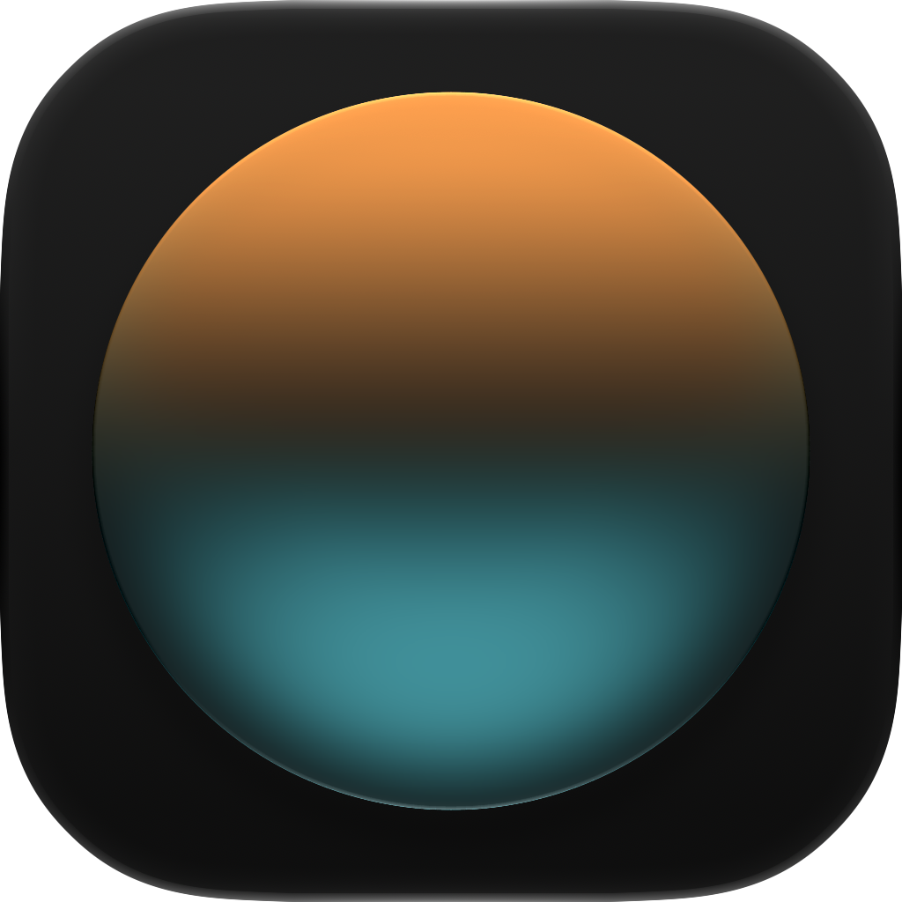

  <!-- App Icon -->
  

  <h1> Learning Journey </h1>

  

    <strong>A focused daily habit and learning tracker built to help you stay consistent without burnout.</strong> 
    Set a learning goal across a week, month, or year, build your daily streak, and use smart freezes to protect your progress when life gets busy.
  

  <!-- Clean, Minimalist Text Pills instead of old badges -->
  

    <code></code> •
   <code></code> •
    <code></code>
  

  

   

  

 

## Main Features

<table>
  <tr>
    <td width="50%" valign="top">
      <h3>  Custom Learning Goals</h3>
      
Choose what you want to learn and commit to a <strong>Week</strong>, <strong>Month</strong>, or <strong>Year</strong> timeframe. Updating your goal starts you fresh by resetting your active streak.

    </td>
    <td width="50%" valign="top">
      <h3>  32-Hour Streak Window</h3>
      
Log your daily learning session with a single tap. If more than <strong>32 hours</strong> pass without logging or freezing, your streak resets automatically.

    </td>
  </tr>
  <tr>
    <td width="50%" valign="top">
      <h3>  Smart Streak Freezes</h3>
      
Protect your streak on busy days with duration-based freeze allowances: 
      • <strong>Week:</strong> <code>2 Freezes</code> 
      • <strong>Month:</strong> <code>8 Freezes</code> 
      • <strong>Year:</strong> <code>96 Freezes</code>

    </td>
    <td width="50%" valign="top">
      <h3>  Automatic 12:00 AM Reset</h3>
      
Once a day is logged or frozen, buttons lock for the rest of the day and re-enable at <strong>12:00 AM midnight</strong>—even if logged at 11:00 PM.

    </td>
  </tr>
</table>

    <strong>Context-Aware Grammar:</strong> Dynamic UI labels automatically adapt between singular (<code>1 Day</code>) and plural (<code>2 Days</code>, <code>3 Days</code>) across both streak and freeze counters.

 

## App Preview

  

 

## Technologies Used

- **SwiftUI** — Declarative dark-mode user interface and custom circular controls
- **SwiftData** — Local persistence for goals, daily activity logs, and freeze counts
- **MVVM Architecture** — Clean separation between state logic (`LearningViewModel`) and views (`ActivityView`)
- **Foundation (`Calendar` and `Timer`)** — Exact midnight rollover calculations and 32-hour inactivity checks

 

  

